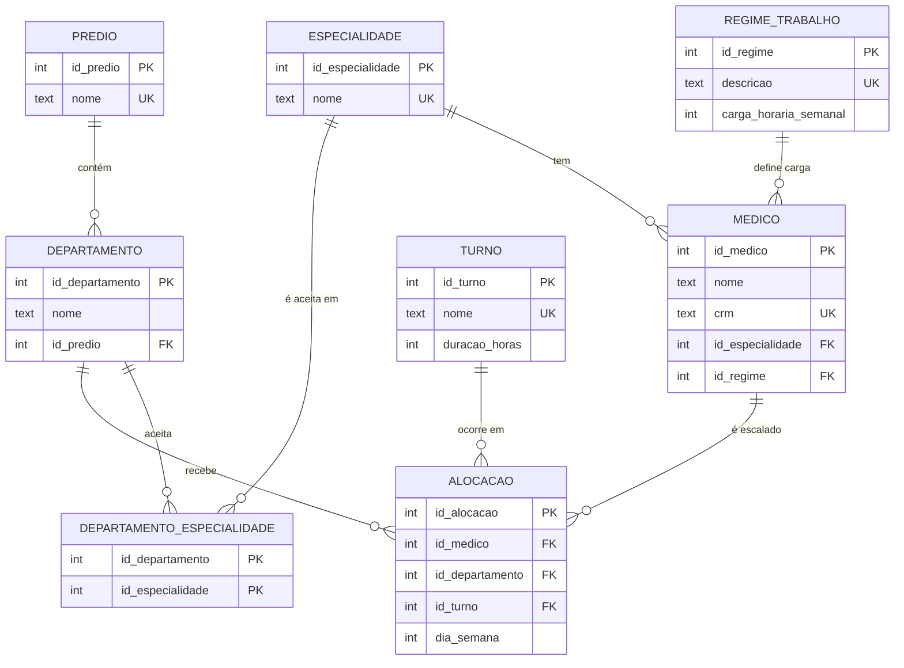

# Projeto Escala Médica

Aplicação que organiza a escala semanal dos médicos de um hospital e responde à pergunta:

> **Em qual prédio e departamento o médico X está no dia Y, turno Z?**

O projeto é dividido em duas partes:

| Parte | Conteúdo | Pasta / Arquivo |
|---|---|---|
| **Parte 1** | Modelagem, scripts DDL/DML, banco SQLite e consultas SQL | `database/`, `consultas.sql` |
| **Parte 2** | API REST desenvolvida em Spring Boot sobre o banco SQLite | `backend/` |

---

## 📁 Estrutura do Projeto

```
projeto-escala-medica/
├── README.md                   # Documentação do projeto
├── consultas.sql               # Arquivo com as consultas SQL obrigatórias (Q1 a Q6)
├── database/
│   ├── base/hospital.sqlite    # Banco fornecido (médicos, especialidades, regimes)
│   ├── ddl/                    # 01 a 05: Scripts CREATE TABLE das tabelas novas
│   ├── dml/                    # 01 a 05: Scripts INSERTs de prédios, departamentos, turnos e escala
│   ├── queries/                # Consultas individuais (q1 a q6)
│   └── escala.sqlite           # Banco SQLite consolidado (base + DDL + DML)
├── docs/diagramas/             # Diagramas e documentações complementares
└── backend/                    # API REST com Spring Boot (Parte 2)
```

---

## 📊 Modelo de Dados



> **Nota:** As tabelas `medico`, `especialidade` e `regime_trabalho` vêm prontas do banco base (`hospital.sqlite`). As novas tabelas se relacionam com elas via chaves estrangeiras.

---

## 📋 Regras de Negócio

| Regra | Descrição | Onde é garantida |
|---|---|---|
| **RN01** | Médico não pode ter duas alocações no mesmo dia e turno | Restrição `UNIQUE` no banco + validação no serviço |
| **RN02** | Departamento precisa aceitar a especialidade do médico | Validação no serviço (`AlocacaoService`) e consulta Q4 |
| **RN03** | Soma das horas alocadas não pode passar da carga do regime | Validação no serviço (`AlocacaoService`) e consulta Q5 |
| **RN04** | `dia_semana` válido de 1 (segunda-feira) a 7 (domingo) | Restrição `CHECK` no banco + anotações `@Min/@Max` |
| **RN05** | Todo departamento deve obrigatoriamente pertencer a um prédio | Chave estrangeira `NOT NULL` |
| **RN06** | Não alocar médico, departamento ou turno inexistente | Chaves estrangeiras no banco + serviço |

---

## 🔍 Consultas SQL (Q1 a Q6)

Todas as consultas estão consolidadas no arquivo [`consultas.sql`](consultas.sql) e organizadas individualmente em [`database/queries/`](database/queries/):

| Consulta | Descrição | Objetivo |
|---|---|---|
| **Q1** | Escala semanal completa de um médico | Lista os dias, turnos, prédios e departamentos onde o médico especificado (por CRM) está alocado. |
| **Q2** | Médicos presentes em prédio por dia e turno | Identifica médicos alocados em determinado prédio (ex: Bloco C) na quarta-feira à tarde. |
| **Q3** | Médicos sem alocação | Lista todos os médicos cadastrados que ainda não possuem escalas atribuídas na semana. |
| **Q4** | Alocações incompatíveis (RN02) | Verifica alocações em departamentos que não aceitam a especialidade do médico (retorno esperado: **vazio**). |
| **Q5** | Carga alocada x Regime de trabalho (RN03) | Compara o total de horas alocadas na semana com a carga horária contratada de cada médico. |
| **Q6** | Quantidade de médicos por departamento e dia | Agrupa a quantidade de médicos distintos atuando em cada departamento por dia da semana. |

---

## 🚀 Como Executar

### 1. Banco de Dados SQLite

O banco consolidado já está disponível em `database/escala.sqlite`. Caso deseje recriá-lo do zero a partir da base e dos scripts:

```bash
cd database
cp base/hospital.sqlite escala.sqlite
cat ddl/*.sql dml/*.sql | sqlite3 -cmd "PRAGMA foreign_keys = ON;" escala.sqlite
```

Para executar as consultas SQL:
* Abra o arquivo [`consultas.sql`](consultas.sql) em ferramentas como **DBeaver**, **DB Browser for SQLite** ou no terminal SQLite.

### 2. Backend (Spring Boot)

**Requisitos:** Java 17 ou superior. O Maven Wrapper já vem incluso no projeto.

```bash
cd backend

# Linux / macOS
./mvnw spring-boot:run

# Windows
mvnw.cmd spring-boot:run
```

A API iniciará por padrão em `http://localhost:8080` (ou porta configurada) conectada ao banco `database/escala.sqlite`.
* Para a lista completa de endpoints, veja [`backend/README.md`](backend/README.md).
* Exemplos de requisições prontas para testes estão em [`backend/requests.http`](backend/requests.http).
