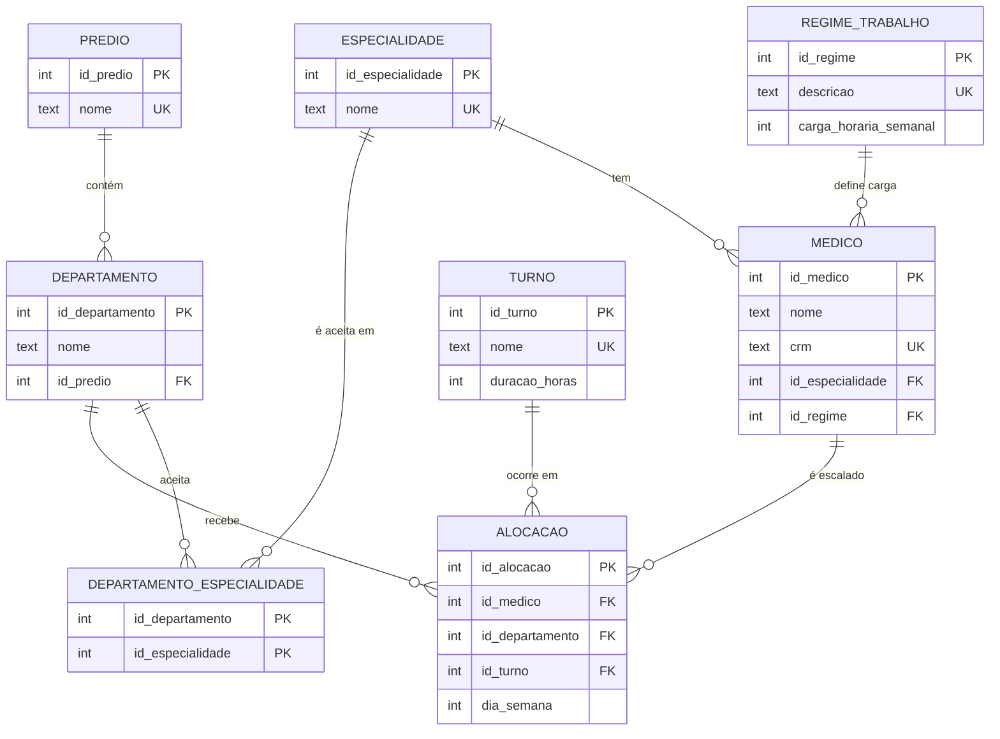

# Projeto Escala Médica

Aplicação que organiza a escala semanal dos médicos de um hospital e responde à pergunta:

> **Em qual prédio e departamento o médico X está no dia Y, turno Z?**

O projeto tem duas partes:

| Parte | Aula | Conteúdo | Pasta |
|---|---|---|---|
| 1 | Aula 1 | Modelagem, scripts DDL/DML e consultas SQL | `database/`, `docs/` |
| 2 | Aula 2 | API REST com Spring Boot sobre o mesmo banco | `backend/` |

> Este repositório é a **solução de referência do professor**.

## Estrutura

```
projeto-escala-medica/
├── README.md
├── database/
│   ├── base/hospital.sqlite        banco fornecido (médicos, especialidades, regimes)
│   ├── ddl/                        01 a 05: CREATE TABLE das tabelas novas
│   ├── dml/                        01 a 05: INSERTs de prédios, departamentos, turnos e escala
│   ├── queries/                    Q1 a Q6: consultas obrigatórias
│   └── escala.sqlite               banco final (base + DDL + DML), usado pelo backend
├── docs/diagramas/
└── backend/                        projeto Spring Boot (Parte 2)
```

## Modelo de dados



`medico`, `especialidade` e `regime_trabalho` vêm prontas no `hospital.sqlite` e **não são alteradas**.
As tabelas novas apenas apontam para elas por chave estrangeira, por isso nenhum `ALTER TABLE` é necessário.

## Regras de negócio

| Regra | Descrição | Onde é garantida |
|---|---|---|
| RN01 | Médico não pode ter duas alocações no mesmo dia e turno | `UNIQUE` no banco + serviço |
| RN02 | Departamento precisa aceitar a especialidade do médico | serviço (`AlocacaoService`) |
| RN03 | Soma das horas não pode passar da carga do regime | serviço (`AlocacaoService`) |
| RN04 | `dia_semana` de 1 (segunda) a 7 (domingo) | `CHECK` no banco + `@Min/@Max` |
| RN05 | Todo departamento pertence a um prédio | FK `NOT NULL` |
| RN06 | Não alocar médico, departamento ou turno inexistente | FK no banco + serviço |

## Parte 1: montar o banco

1. Copie `database/base/hospital.sqlite` para `database/escala.sqlite`.
2. Abra a cópia no DB Browser for SQLite, DBeaver ou `sqlite3`.
3. Execute `PRAGMA foreign_keys = ON;`.
4. Rode os scripts de `ddl/` e depois os de `dml/`, sempre na ordem numérica.
5. Confira com as consultas de `queries/`. A Q4 deve retornar vazio.

Com o `sqlite3` no terminal:

```bash
cd database
cp base/hospital.sqlite escala.sqlite
cat ddl/*.sql dml/*.sql | sqlite3 -cmd "PRAGMA foreign_keys = ON;" escala.sqlite
```

## Parte 2: rodar o backend

Requisitos: **Java 17 ou superior**. O Maven não precisa estar instalado, o wrapper (`mvnw`) baixa sozinho.

```bash
cd backend
./mvnw spring-boot:run          # Linux / macOS
mvnw.cmd spring-boot:run        # Windows
```

A API sobe em `http://localhost:8080` usando `../database/escala.sqlite`.
Veja `backend/README.md` para a lista de endpoints e `backend/requests.http` para requisições prontas.
